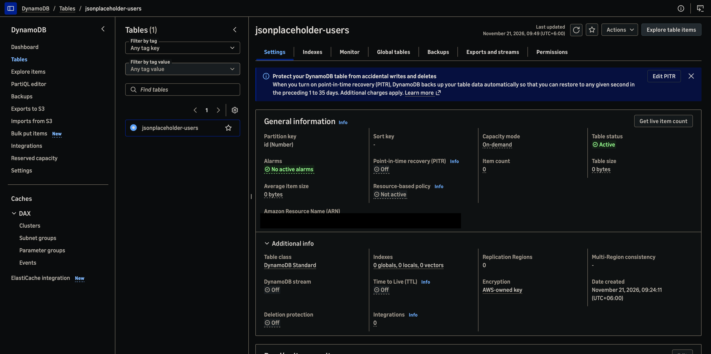
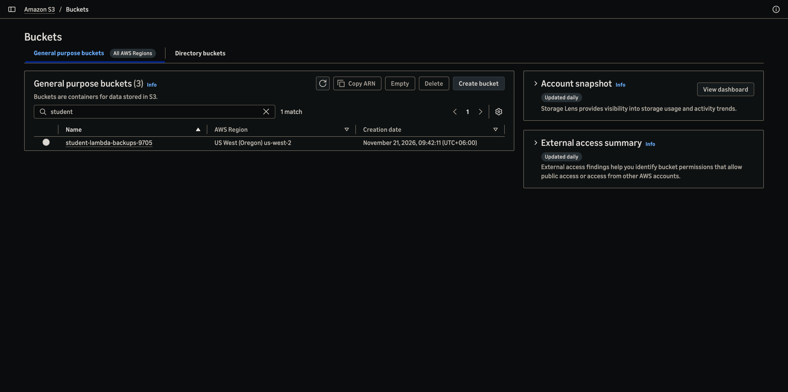

# AWS Lambda + DynamoDB + Scheduled S3 Backups

A serverless pipeline built in the AWS Management Console. One Lambda function loads 10 demo users from a public API into DynamoDB. A second Lambda function exports the whole table as a new timestamped JSON file in a private S3 bucket. EventBridge Scheduler runs that export every 2 minutes, and CloudWatch shows the logs and metrics for both functions.

Everything was built in **US West (Oregon), `us-west-2`**, on 21 November 2026, then deleted at the end. The original task description is in [ASSIGNMENT.md](ASSIGNMENT.md).

> **About the screenshots:** the AWS console's top bar, which shows the account name and ID, is cropped off every screenshot. The account ID inside ARNs is blacked out.

## Architecture

```text
            https://jsonplaceholder.typicode.com/users
                              |
                              | HTTP GET (10 demo users)
                              v
            [Lambda #1: import-jsonplaceholder-users]
                              |
                              | dynamodb:PutItem
                              v
               [DynamoDB table: jsonplaceholder-users]
                              |
                              | dynamodb:Scan
                              v
            [Lambda #2: export-dynamodb-to-s3]  <---  [EventBridge Scheduler]
                              |                         rate(2 minutes)
                              | s3:PutObject
                              v
            [Private S3 bucket: student-lambda-backups-9705]
               backups/YYYY-MM-DD/users-HH-MM-SS-ffffff-REQUEST_ID.json

            Both functions ---> CloudWatch Logs + CloudWatch Metrics
```

How the data flows:

1. **Lambda #1** (run by hand from the Test tab) calls the JSONPlaceholder API and gets a list of 10 users. It writes each one to DynamoDB with `PutItem`, using the user's `id` as the key.
2. **DynamoDB** stores the users, including the nested `address` and `company` objects.
3. **Lambda #2** reads the whole table with `Scan`, following `LastEvaluatedKey` if there's more than one page. It sorts the users by `id` and uploads them as one JSON array to S3 with `PutObject`.
4. **EventBridge Scheduler** invokes Lambda #2 every 2 minutes, so a new backup file appears in S3 every 2 minutes without anyone touching it.
5. **CloudWatch** keeps each function's `print()` output in its log group, and the invocation, duration and error metrics.

Neither function has any AWS keys in its code. Boto3 gets temporary credentials from each function's IAM execution role.

## Resources created

| Resource | Name | Key settings |
| --- | --- | --- |
| DynamoDB table | `jsonplaceholder-users` | Partition key `id` (Number), no sort key, on-demand capacity |
| S3 bucket | `student-lambda-backups-9705` | `us-west-2`, Block all public access **On**, no bucket policy, default encryption |
| Lambda #1 | `import-jsonplaceholder-users` | Python 3.12, 128 MB, 30 s timeout, handler `lambda_function.lambda_handler` |
| Lambda #2 | `export-dynamodb-to-s3` | Python 3.12, 128 MB, 30 s timeout, handler `lambda_function.lambda_handler` |
| Inline IAM policy | `AllowPutDemoUsers` | On Lambda #1's role: `dynamodb:PutItem` on the table only |
| Inline IAM policy | `AllowDynamoDBJsonBackup` | On Lambda #2's role: `dynamodb:Scan` on the table, `s3:PutObject` on `backups/*` only |
| EventBridge schedule | `dynamodb-backup-every-2min` | `rate(2 minutes)`, flexible time window off, target Lambda #2, its own Scheduler role |
| S3 lifecycle rule (optional) | `expire-demo-backups-after-7-days` | Prefix `backups/`, current versions expire after 7 days |

## Repository layout

```text
.
├── README.md          this report
├── ASSIGNMENT.md      the original assignment instructions
├── lambda_src/        Python source of both functions (unchanged)
├── lambda_zips/       the two ZIPs uploaded to Lambda (unchanged)
├── iam_policies/      policy templates; REGION, ACCOUNT_ID and the bucket name stay as placeholders
└── screenshots/       the 32 screenshots used below
```

---

## Part A: DynamoDB table and S3 bucket

**Step 1–2. The DynamoDB table.** I created `jsonplaceholder-users` with the partition key `id` of type **Number**, because the API's ids are numbers (1–10). The item count is 0 here because nothing had been imported yet.



**Step 3. The private S3 bucket.** I created `student-lambda-backups-9705` in the same Region as everything else.



**Block all public access** stayed **On** and the bucket has no bucket policy, so the backups are private.


