# Serverless DynamoDB → S3 Backup Pipeline on AWS

An event-driven data pipeline built entirely from managed AWS services. One Lambda function pulls user records from a public REST API and stores them in DynamoDB. A second Lambda function exports the whole table to a private S3 bucket as a timestamped JSON file. EventBridge Scheduler runs the export every 2 minutes, unattended. Every role has least-privilege permissions, and both functions are observable through CloudWatch logs and metrics.

**Tech stack:** AWS Lambda (Python 3.12, Boto3) · Amazon DynamoDB · Amazon S3 · Amazon EventBridge Scheduler · AWS IAM · Amazon CloudWatch

## Highlights

- **Fully serverless and scheduled.** There are no servers or cron hosts to manage. EventBridge Scheduler invoked the export Lambda **23 times in 3 hours with 0 errors and a 100% success rate**, writing a new file every 2 minutes.
- **Least-privilege IAM.** The import function can only `PutItem` into one table. The export function can only `Scan` that table and `PutObject` under one S3 prefix. The scheduler has its own role that can only invoke the export function.
- **Safe to re-run.** Imports are idempotent: running the import again replaces records by key instead of duplicating them.
- **Backups that never overwrite.** Every export gets a unique, sortable key built from the UTC timestamp and the Lambda request ID, which also links each file to its log lines.
- **Private by default.** The S3 bucket has Block Public Access on and no bucket policy. No credentials are in the code, because Boto3 uses each function's execution role.
- **Cost-aware.** A 7-day S3 lifecycle rule expires old backups, and every resource was torn down at the end.

Built and tested in **`us-west-2` (Oregon)** in November 2026, then fully torn down.

> **About the screenshots:** the AWS console's top bar, which shows the account name and ID, is cropped off every screenshot. The account ID inside ARNs is blacked out.

## Architecture

```text
            https://jsonplaceholder.typicode.com/users
                              |
                              | HTTP GET (10 user records)
                              v
            [Lambda: import-jsonplaceholder-users]
                              |
                              | dynamodb:PutItem
                              v
               [DynamoDB table: jsonplaceholder-users]
                              |
                              | dynamodb:Scan
                              v
            [Lambda: export-dynamodb-to-s3]  <---  [EventBridge Scheduler]
                              |                      rate(2 minutes)
                              | s3:PutObject
                              v
            [Private S3 bucket: student-lambda-backups-9705]
               backups/YYYY-MM-DD/users-HH-MM-SS-ffffff-REQUEST_ID.json

            Both functions ---> CloudWatch Logs + CloudWatch Metrics
```

How the data flows:

1. **Import function** (run on demand). Calls the JSONPlaceholder API, checks that each record has an integer `id`, and writes it to DynamoDB with `PutItem`, keyed on `id`.
2. **DynamoDB** stores each record in full, including nested objects such as `address` and `company`.
3. **Export function.** Reads the whole table with a paginated `Scan` that follows `LastEvaluatedKey`. It converts DynamoDB's `Decimal` numbers into JSON-safe values, sorts the records by `id`, and uploads them as one JSON array with `PutObject`.
4. **EventBridge Scheduler** invokes the export function every 2 minutes through its own execution role.
5. **CloudWatch** keeps each function's application logs, and Lambda's built-in metrics: invocations, duration and errors.

## Infrastructure

| Resource | Name | Configuration |
| --- | --- | --- |
| DynamoDB table | `jsonplaceholder-users` | Partition key `id` (Number), on-demand capacity |
| S3 bucket | `student-lambda-backups-9705` | Block all public access **On**, no bucket policy, default encryption |
| Lambda function | `import-jsonplaceholder-users` | Python 3.12, 128 MB, 30 s timeout, env `TABLE_NAME` |
| Lambda function | `export-dynamodb-to-s3` | Python 3.12, 128 MB, 30 s timeout, env `TABLE_NAME`, `BUCKET_NAME`, `BACKUP_PREFIX` |
| IAM inline policy | `AllowPutDemoUsers` | Import role: `dynamodb:PutItem` on the table only |
| IAM inline policy | `AllowDynamoDBJsonBackup` | Export role: `dynamodb:Scan` on the table, `s3:PutObject` on `backups/*` only |
| EventBridge schedule | `dynamodb-backup-every-2min` | `rate(2 minutes)`, flexible time window off, its own Scheduler role |
| S3 lifecycle rule | `expire-demo-backups-after-7-days` | Prefix `backups/`, objects expire after 7 days |

## Security: least-privilege IAM

Each role allows only the API calls its code makes, on only the resources it needs:

| Role | Allowed | Why |
| --- | --- | --- |
| Import function | `dynamodb:PutItem` on the table | It only **writes** records. It never reads the table and never touches S3. |
| Export function | `dynamodb:Scan` on the table | It has to **read every item**. |
| Export function | `s3:PutObject` on `bucket/backups/*` | It only **creates** new files, and only under `backups/`. It can't read, list or delete objects. |
| Both functions | `AWSLambdaBasicExecutionRole-…` | To write their logs to CloudWatch. |
| Scheduler role | `lambda:InvokeFunction` on the export function | To start the export, and nothing else. |

So a bug in the export function couldn't change the table or delete earlier backups. The policy templates in [`iam_policies/`](iam_policies) keep `REGION`, `ACCOUNT_ID` and the bucket name as placeholders; the real values go into IAM only.

---

## How I built it

### 1. Storage: DynamoDB table and private S3 bucket

The table uses `id` (Number) as its partition key, because the API's ids are integers. The item count is 0 here because nothing had been imported yet.


The backup bucket lives in the same Region as everything else.


**Block all public access** is on and there's no bucket policy, so the backups stay private.


### 2. Import function: API → DynamoDB

The timeout is raised from the default 3 seconds to **30 seconds**, because the function calls an external API.


Its role has one inline policy, `AllowPutDemoUsers`, which allows only `dynamodb:PutItem` on this table, plus the managed logging policy.


The table name comes from an environment variable rather than being hardcoded.

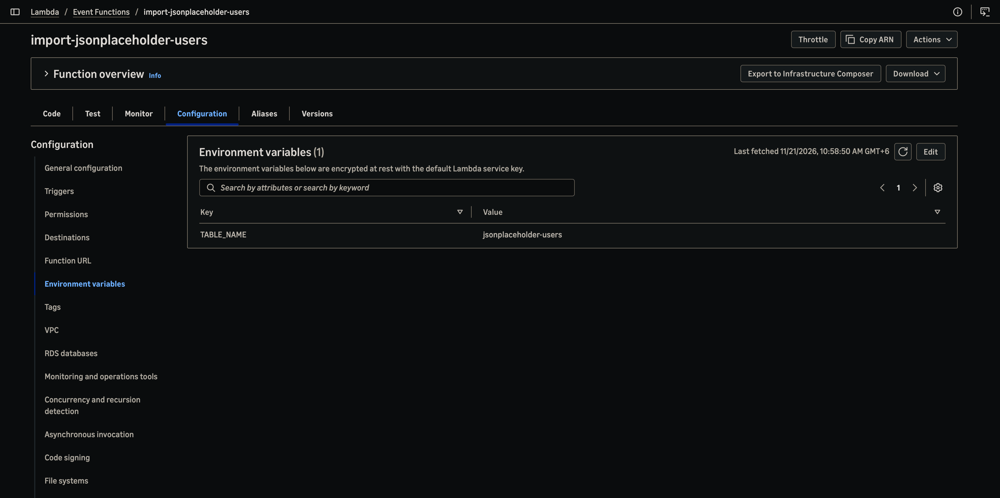

The code is deployed from [`lambda_zips/lambda-import-users.zip`](lambda_zips) with the handler `lambda_function.lambda_handler`.

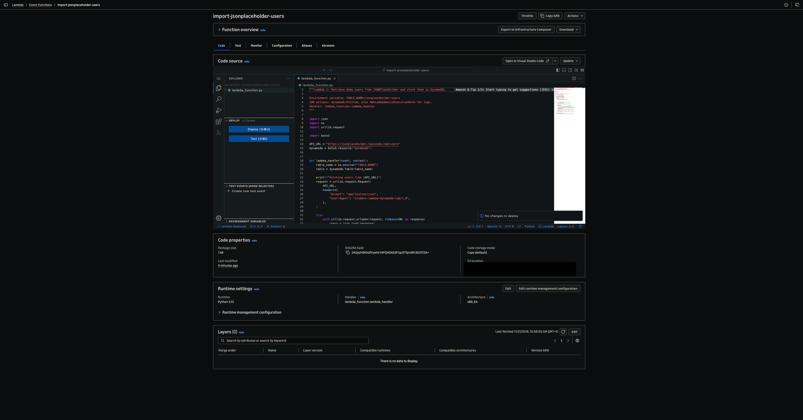

A test run returned `statusCode 200` and `saved_count: 10` in about 940 ms.

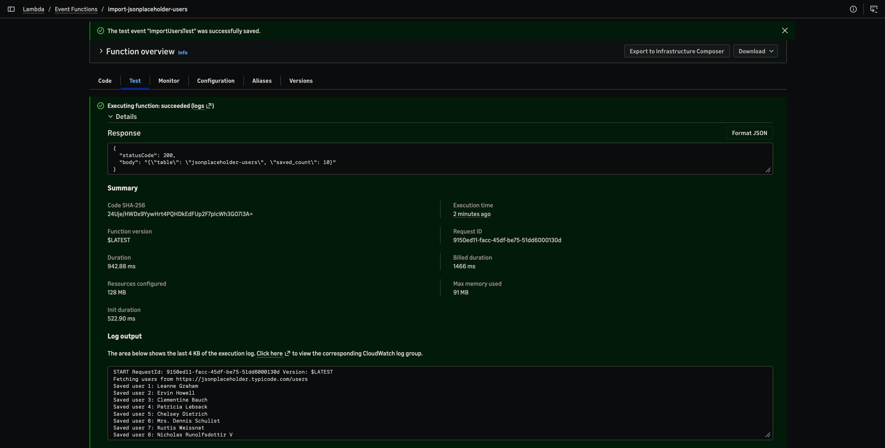

The function's log stream shows every record being saved, then a `SUCCESS` line.

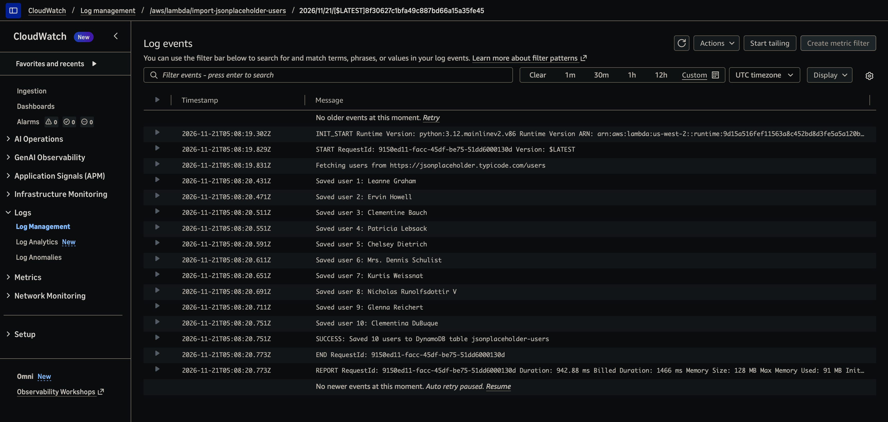

A table scan returns **10 items**, one per record.

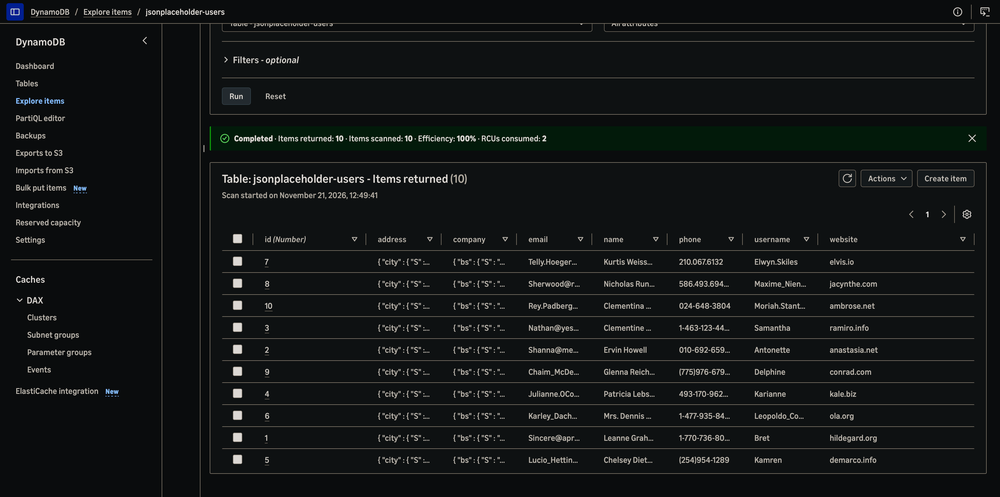

Each item keeps the full record, including the nested `address` (with `geo`) and `company` objects.


Running the import a second time still leaves 10 items, because `PutItem` replaces records with the same key (see [idempotent imports](#idempotent-imports-why-re-running-the-import-doesnt-duplicate-data)).

### 3. Export function: DynamoDB → S3

The export function has the same runtime settings as the import function.

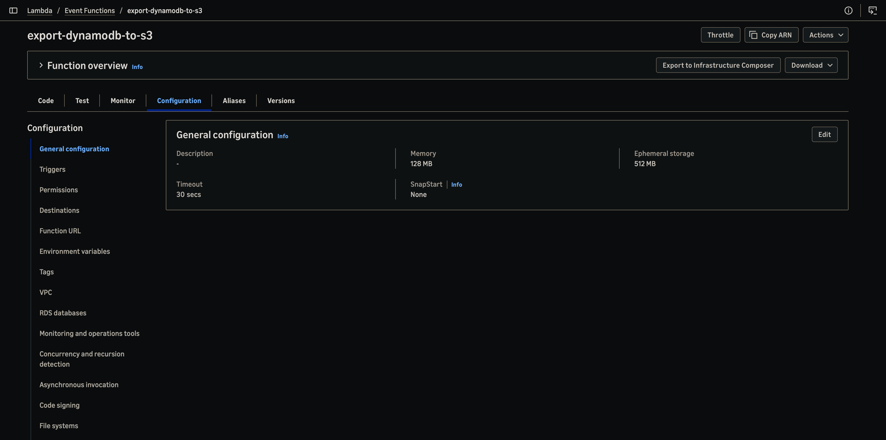

Its inline policy `AllowDynamoDBJsonBackup` allows `dynamodb:Scan` on the table and `s3:PutObject` only under `backups/`.

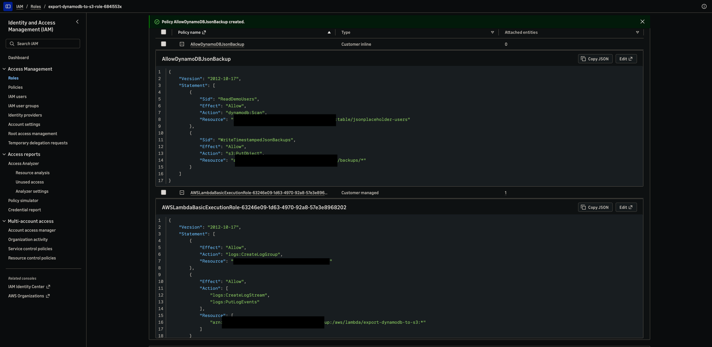

The table, the bucket and the key prefix are all set through environment variables.


A manual run exported 10 records in about 550 ms. It returned the new file's `s3_uri` and `scan_pages: 1`, since the whole table fits in one scan page.


Two manual runs produced two separate files. Nothing was overwritten.


Each file is a JSON array of every record, with all fields and nested objects:


The export logs show the scan (`Read 10 items over 1 DynamoDB scan page(s)`) and the exact S3 URI of each file.

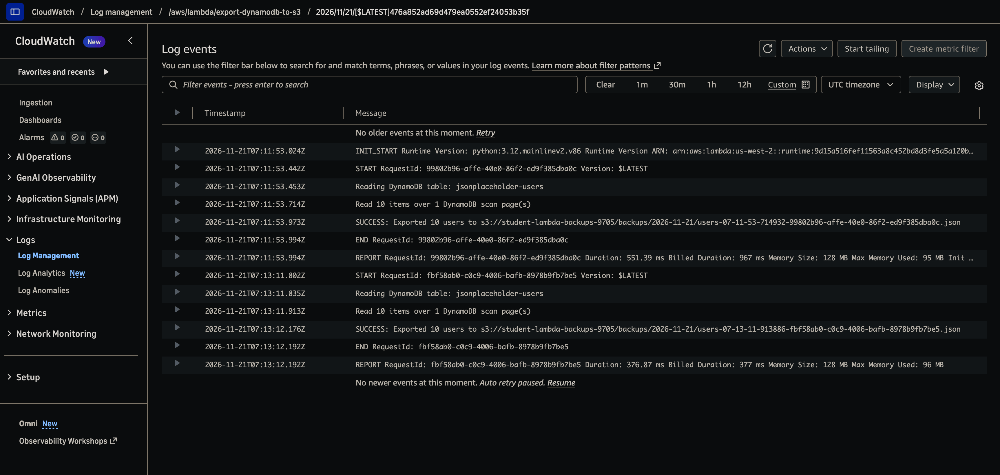

### 4. Scheduling with EventBridge Scheduler

`dynamodb-backup-every-2min` is a recurring rate-based schedule, `rate(2 minutes)`, with no flexible time window.


It targets the export function with an empty `{}` payload. It runs under its own Scheduler execution role, which is separate from the function's role (see [separate roles](#separate-roles-the-functions-execution-role-vs-the-schedulers-role)).

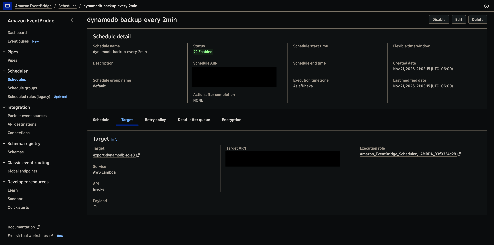

With nobody touching it, a new backup landed **exactly every 2 minutes**: 17 scheduled files next to the 2 manual ones.

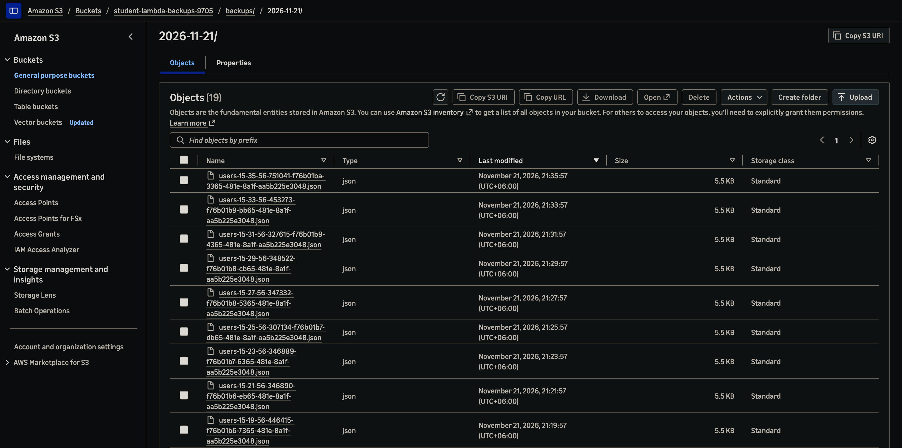

The logs show the same runs. The file names in the `SUCCESS` lines (`users-15-33-56-…`, `users-15-35-56-…`) are the newest files in the S3 list above.


### 5. Monitoring and retention

The export function over 3 hours: **23 invocations**, about **500 ms average duration** (462–608 ms), **0 errors** and a **100% success rate**.

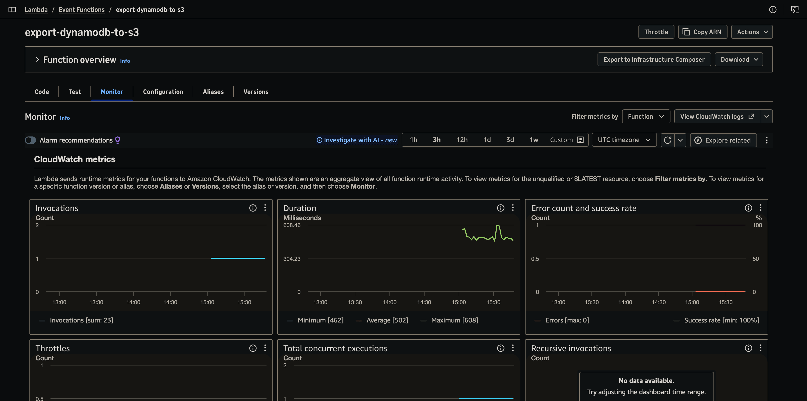

The import function over 1 day: **2 invocations**, both successful. The second one was the re-run that confirmed imports are idempotent.

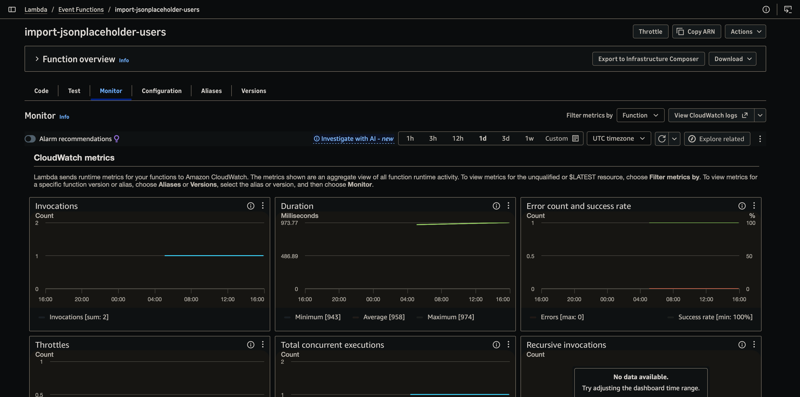

A lifecycle rule expires everything under `backups/` after 7 days, so a forgotten schedule can't fill the bucket for ever.


### 6. Teardown

I removed every resource, stopping the schedule first so no new files were written during cleanup.

1. **Disabled** the schedule.

   

2. **Deleted** the schedule.

   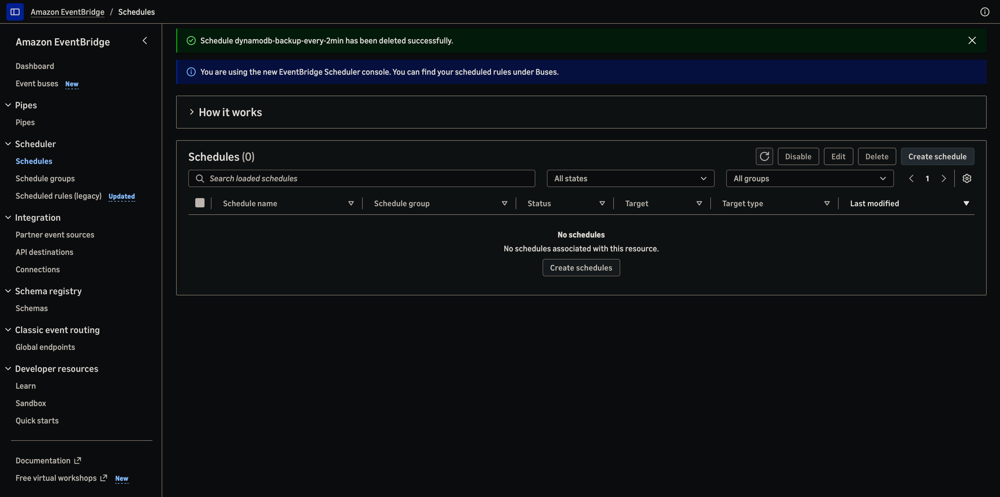

3. **Emptied and deleted** the S3 bucket.

   

4. **Deleted** both Lambda functions.

   

5. **Deleted** the DynamoDB table.

   

6. **Deleted** the log groups. They stay behind after their functions are deleted, so they need removing separately.

   

7. **Deleted** the three IAM roles: both function roles and the Scheduler role.

   

---

## Design decisions

### Separate roles: the function's execution role vs the Scheduler's role

- **The function's execution role** is assumed by **Lambda** while the code runs. It decides **what the code can do**, and Boto3 picks up its temporary credentials automatically. Here, that's `PutItem` for the import function, and `Scan` plus `PutObject` for the export function.
- **The Scheduler's execution role** is assumed by **EventBridge Scheduler** when the schedule fires. It decides **what Scheduler can start**: only `lambda:InvokeFunction` on the export function. It has no access to DynamoDB or S3.

Keeping them apart means the thing that *triggers* the export can't touch the data, and the export function can't trigger anything.

### Idempotent imports: why re-running the import doesn't duplicate data

`id` is the table's partition key, which makes it each item's unique identifier. `PutItem` writes a whole item and **replaces** any existing item with the same key. The API returns the same records with ids 1–10 every time, so a second run overwrites them with identical data, and the table stays at 10 items. That makes the import safe to retry. If every run's data had to be kept instead, each write would need a different key, such as an added sort key for the import time.

### Unique backup keys: timestamps and request IDs

Every export is written to its own key:

```text
backups/<UTC date>/users-<HH-MM-SS-microseconds>-<Lambda request ID>.json
e.g. backups/2026-11-21/users-07-11-53-714932-99802b96-affe-40e0-86f2-ed9f385dba0c.json
```

- **No overwriting.** `PutObject` replaces an object with the same key. A new key each run keeps every export as its own file.
- **Unique even at the same instant.** A manual run, a scheduled run or a retry in the same second still get different keys. The microseconds differ, and the request ID is unique per invocation.
- **Traceable.** The request ID links each file to its exact log lines. The file above matches `RequestId: 99802b96-…` in CloudWatch.
- **Sortable.** Date folders and UTC times keep files in order, whatever the viewer's time zone.

### Logs vs metrics

- **Logs** (`print()` output in CloudWatch Logs) show **what happened inside a run**: `Saved user 3: Clementine Bauch`, `Read 10 items…`, or an `ERROR:` with its reason, plus Lambda's `START`, `END` and `REPORT` lines.
- **Metrics** (`Invocations`, `Errors`, `Duration`) are numbers Lambda publishes automatically. They show **how often the function ran, how long it took and whether it failed**, over time.

Metrics are for noticing a problem, such as errors above 0 or a missing run. Logs are for finding out why. Both functions re-raise exceptions after logging `ERROR:`. If they swallowed the error and returned normally, the failed run would still count as a success in the `Errors` metric.

### What a JSON export can and can't restore

If the table were deleted, the **data** would survive in the JSON files, but **nothing would come back automatically**:

- A file is only an array of items. It has no table name, no key schema, capacity mode, secondary indexes, TTL, streams, PITR setting, encryption, tags or alarms.
- To restore, I'd have to recreate the table by hand with the right key schema, then run a script that writes each record back with `PutItem` or `BatchWriteItem`.
- Types may not come back exactly as they were. Non-whole DynamoDB numbers are exported as strings, and a `Scan` isn't a consistent point-in-time snapshot.

Real restores should use DynamoDB's own backups (on-demand backup, PITR or AWS Backup), which restore the data and the table's structure.

### Production considerations: why I wouldn't run this for a large table

The design works for a small demo table. For a large production table, a full export every 2 minutes would be a poor backup strategy:

- **Full scans are expensive.** Each run reads every item, 720 times a day, even when nothing has changed. That uses read capacity and competes with application traffic.
- **Lambda limits.** A run can last at most 15 minutes, and this code holds every item in memory to write a single file.
- **Not a consistent snapshot.** A scan reads pages over time while the table changes, and it doesn't capture configuration.
- **Storage grows fast.** About 720 full copies a day, over 21,000 a month, without a lifecycle rule.
- **Runs can overlap.** If one export takes longer than 2 minutes, the next one starts before it finishes.

In production I'd use **DynamoDB point-in-time recovery** (restore to any second in the last 35 days), on-demand backups or **AWS Backup**, and the managed **DynamoDB export to S3** (full or incremental, without using table read capacity). I'd choose the backup interval and retention from the workload's RPO and RTO.

---

## Repository layout

```text
.
├── README.md          this document
├── lambda_src/        Python source of both functions
├── lambda_zips/       the deployment packages uploaded to Lambda
├── iam_policies/      IAM policy templates (REGION, ACCOUNT_ID and bucket name are placeholders)
└── screenshots/       the console screenshots used above
```

## Notes

- **Time zones.** S3 folder dates, file-name times and CloudWatch timestamps are in **UTC**. The S3 "Last modified" column shows local time (**UTC+6**). For example, `users-15-35-56-….json` shows as last modified at 21:35:57.
- **The schedule is approximate.** `rate(2 minutes)` ran about every 2 minutes, give or take a second (15:33:56, 15:35:57, 15:37:56 …).
- **Credits.** The two Lambda functions' Python code and the IAM policy templates came from cloud-course starter files. I built and ran everything on the AWS side: provisioning, IAM, configuration, scheduling, verification, monitoring and teardown.
