# AWS Lambda + DynamoDB + Scheduled S3 Backups

A serverless pipeline built in the AWS Management Console. One Lambda function loads 10 demo users from a public API into DynamoDB. A second Lambda function exports the whole table as a new timestamped JSON file in a private S3 bucket. EventBridge Scheduler runs that export every 2 minutes, and CloudWatch shows the logs and metrics for both functions.

Everything was built in **US West (Oregon), `us-west-2`**, on 21 November 2026, then deleted at the end. The original task description is in [ASSIGNMENT.md](ASSIGNMENT.md).

> **About the screenshots:** the AWS console's top bar, which shows the account name and ID, is cropped off every screenshot. The account ID inside ARNs is blacked out.

## Architecture

```text
            https://jsonplaceholder.typicode.com/users
                              |
                              | HTTP GET (10 demo users)
                              v
            [Lambda #1: import-jsonplaceholder-users]
                              |
                              | dynamodb:PutItem
                              v
               [DynamoDB table: jsonplaceholder-users]
                              |
                              | dynamodb:Scan
                              v
            [Lambda #2: export-dynamodb-to-s3]  <---  [EventBridge Scheduler]
                              |                         rate(2 minutes)
                              | s3:PutObject
                              v
            [Private S3 bucket: student-lambda-backups-9705]
               backups/YYYY-MM-DD/users-HH-MM-SS-ffffff-REQUEST_ID.json

            Both functions ---> CloudWatch Logs + CloudWatch Metrics
```

How the data flows:

1. **Lambda #1** (run by hand from the Test tab) calls the JSONPlaceholder API and gets a list of 10 users. It writes each one to DynamoDB with `PutItem`, using the user's `id` as the key.
2. **DynamoDB** stores the users, including the nested `address` and `company` objects.
3. **Lambda #2** reads the whole table with `Scan`, following `LastEvaluatedKey` if there's more than one page. It sorts the users by `id` and uploads them as one JSON array to S3 with `PutObject`.
4. **EventBridge Scheduler** invokes Lambda #2 every 2 minutes, so a new backup file appears in S3 every 2 minutes without anyone touching it.
5. **CloudWatch** keeps each function's `print()` output in its log group, and the invocation, duration and error metrics.

Neither function has any AWS keys in its code. Boto3 gets temporary credentials from each function's IAM execution role.

## Resources created

| Resource | Name | Key settings |
| --- | --- | --- |
| DynamoDB table | `jsonplaceholder-users` | Partition key `id` (Number), no sort key, on-demand capacity |
| S3 bucket | `student-lambda-backups-9705` | `us-west-2`, Block all public access **On**, no bucket policy, default encryption |
| Lambda #1 | `import-jsonplaceholder-users` | Python 3.12, 128 MB, 30 s timeout, handler `lambda_function.lambda_handler` |
| Lambda #2 | `export-dynamodb-to-s3` | Python 3.12, 128 MB, 30 s timeout, handler `lambda_function.lambda_handler` |
| Inline IAM policy | `AllowPutDemoUsers` | On Lambda #1's role: `dynamodb:PutItem` on the table only |
| Inline IAM policy | `AllowDynamoDBJsonBackup` | On Lambda #2's role: `dynamodb:Scan` on the table, `s3:PutObject` on `backups/*` only |
| EventBridge schedule | `dynamodb-backup-every-2min` | `rate(2 minutes)`, flexible time window off, target Lambda #2, its own Scheduler role |
| S3 lifecycle rule (optional) | `expire-demo-backups-after-7-days` | Prefix `backups/`, current versions expire after 7 days |

## Repository layout

```text
.
├── README.md          this report
├── ASSIGNMENT.md      the original assignment instructions
├── lambda_src/        Python source of both functions (unchanged)
├── lambda_zips/       the two ZIPs uploaded to Lambda (unchanged)
├── iam_policies/      policy templates; REGION, ACCOUNT_ID and the bucket name stay as placeholders
└── screenshots/       the 32 screenshots used below
```

---

## Part A: DynamoDB table and S3 bucket

**Step 1–2. The DynamoDB table.** I created `jsonplaceholder-users` with the partition key `id` of type **Number**, because the API's ids are numbers (1–10). The item count is 0 here because nothing had been imported yet.


**Step 3. The private S3 bucket.** I created `student-lambda-backups-9705` in the same Region as everything else.


**Block all public access** stayed **On** and the bucket has no bucket policy, so the backups are private.

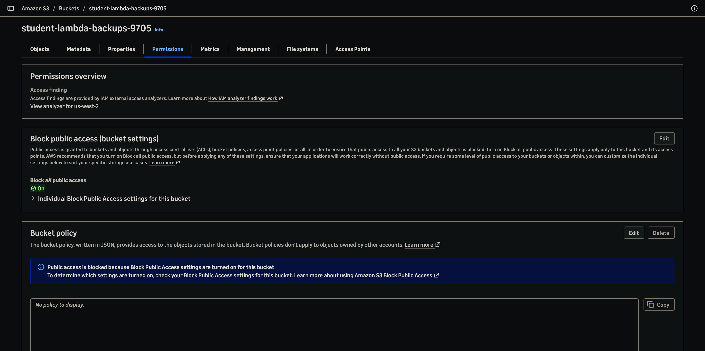

---

## Part B: Lambda #1, import users into DynamoDB

**Step 4. Create the function.** `import-jsonplaceholder-users` uses Python 3.12. I raised the timeout from the default 3 seconds to **30 seconds**, because the function makes an HTTP call to an outside API.


**Step 5. IAM permission.** The function's execution role got one inline policy, `AllowPutDemoUsers`, which allows only `dynamodb:PutItem` on this one table. The second policy, `AWSLambdaBasicExecutionRole-…`, was added by Lambda when it created the role. It lets the function write its logs to CloudWatch.


**Step 6. Environment variable and code.** `TABLE_NAME` tells the code which table to write to, so the table name isn't hardcoded.


I uploaded `lambda_zips/lambda-import-users.zip`. The handler is `lambda_function.lambda_handler` and the runtime is Python 3.12.


**Step 7. Test.** A test event `ImportUsersTest` with `{}` returned `statusCode 200` and `saved_count: 10`.


The log stream in `/aws/lambda/import-jsonplaceholder-users` shows each user being saved, then the `SUCCESS` line.


**Step 8. The data in DynamoDB.** Explore items → Scan returned **10 items**, one per user.


Each item keeps the user's full record, including the nested `address` (with `geo`) and `company` objects.

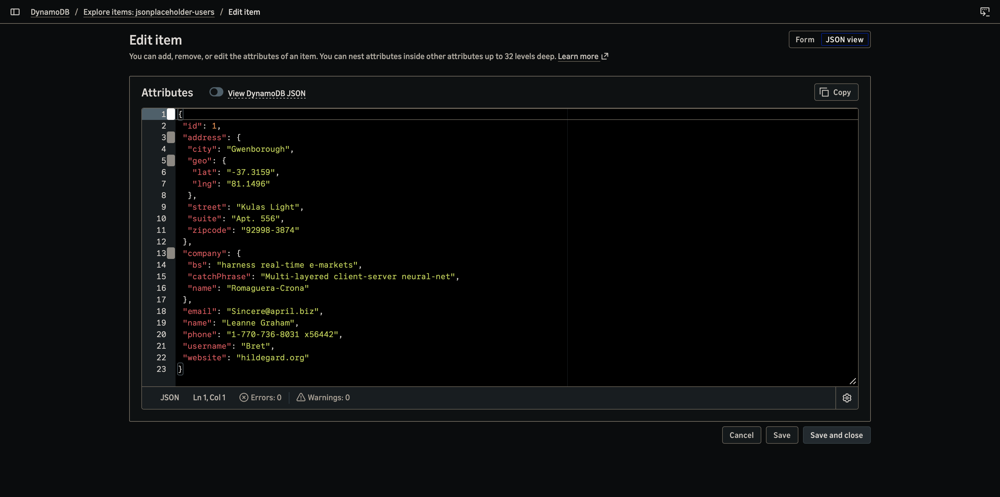

I then ran Lambda #1 a second time, and the table still held 10 items, not 20. The reason is in [question 2](#2-why-does-running-lambda-1-twice-not-produce-20-dynamodb-users) below. Screenshot 24 confirms the two runs.

---

## Part C: Lambda #2, export DynamoDB to S3

**Step 9. Create the function.** `export-dynamodb-to-s3` has the same settings: Python 3.12, 128 MB, 30 seconds.


**Step 10. IAM permissions.** The inline policy `AllowDynamoDBJsonBackup` has two statements:
- `dynamodb:Scan` on the `jsonplaceholder-users` table;
- `s3:PutObject` on `arn:aws:s3:::student-lambda-backups-9705/backups/*`, so the function can only write under `backups/`. It can't read, list or delete anything in the bucket.


**Step 11. Environment variables and code.** The function reads all three settings from environment variables. I uploaded `lambda_zips/lambda-backup-to-s3.zip`, and the handler is `lambda_function.lambda_handler`.

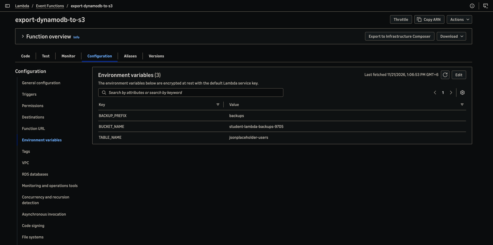

**Step 12. Manual tests.** The test event `ExportUsersTest` (`{}`) returned `exported_count: 10`, the new file's `s3_uri`, and `scan_pages: 1`. The table is tiny, so one scan page held all of it.

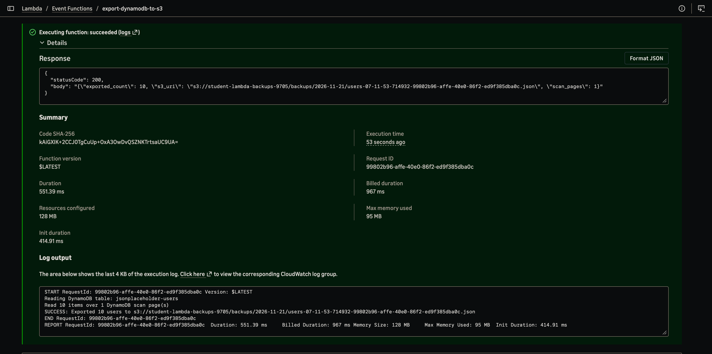

I ran the test twice. Each run created its own file under `backups/2026-11-21/` instead of overwriting the first one.

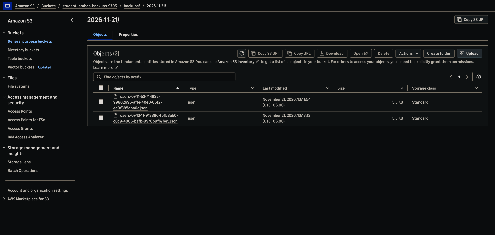

A downloaded backup file is a JSON array of the 10 users, with every field and the nested objects:

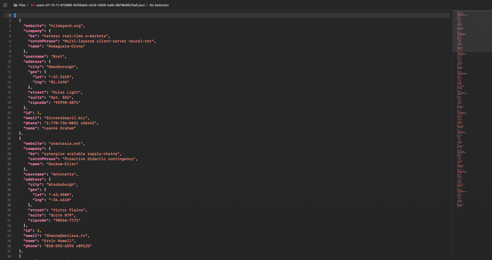

The log stream for `/aws/lambda/export-dynamodb-to-s3` shows both manual runs: reading the table, `Read 10 items over 1 DynamoDB scan page(s)`, and the `SUCCESS` line with the file's S3 URI.


---

## IAM: why each function gets different permissions

Each function's role allows only what its code calls, on only the resource it needs (least privilege):

| Function | Needs | Why |
| --- | --- | --- |
| Lambda #1 (import) | `dynamodb:PutItem` on the table | It only **writes** users into the table. It never reads the table and never touches S3. |
| Lambda #2 (export) | `dynamodb:Scan` on the table | It has to **read every item** in the table. |
| Lambda #2 (export) | `s3:PutObject` on `bucket/backups/*` | It only **creates** new backup files, and only under `backups/`. |
| Both | `AWSLambdaBasicExecutionRole-…` (logs) | To create their log group and stream and write `print()` output to CloudWatch. |

Neither function can delete or change data it doesn't own. If Lambda #2's code had a bug, it still couldn't modify DynamoDB or delete earlier backups. The policy templates in `iam_policies/` keep `REGION`, `ACCOUNT_ID` and `YOUR_UNIQUE_BUCKET_NAME` as placeholders. I entered the real values only in the IAM console.

---

## Part D: a new export every 2 minutes with EventBridge Scheduler

**Step 13. The schedule.** `dynamodb-backup-every-2min` is a recurring, rate-based schedule: `rate(2 minutes)`, with the flexible time window off. It was enabled at 21:03 local time (15:03 UTC).

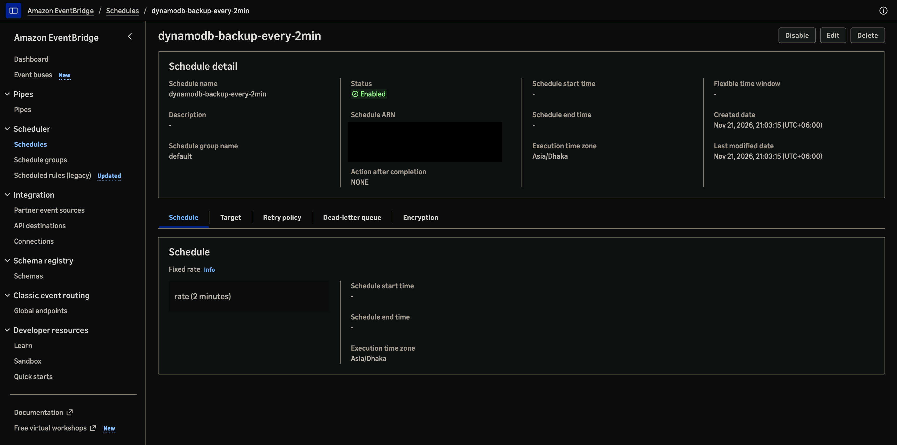

Its target is **AWS Lambda Invoke** on `export-dynamodb-to-s3` with the payload `{}`. The console created a separate **Scheduler execution role**, `Amazon_EventBridge_Scheduler_LAMBDA_…`, which is what allows Scheduler to invoke the function (see [question 1](#1-what-is-the-difference-between-lambdas-execution-role-and-schedulers-execution-role)).


**Step 14. Proof that it runs by itself.** I didn't press Test after creating the schedule. After a while, the date folder held 19 files: the 2 manual ones plus 17 from the schedule. Sorted by Last modified, the scheduled files are **exactly 2 minutes apart** (21:19:57, 21:21:57 … 21:35:57 local time).


Searching Lambda #2's logs for `SUCCESS` shows the same scheduled runs at 15:33:56, 15:35:57, 15:37:56 and 15:39:56 UTC, each exporting 10 users. The files they name (`users-15-33-56-…`, `users-15-35-56-…`) are the same files at the top of the S3 list above.

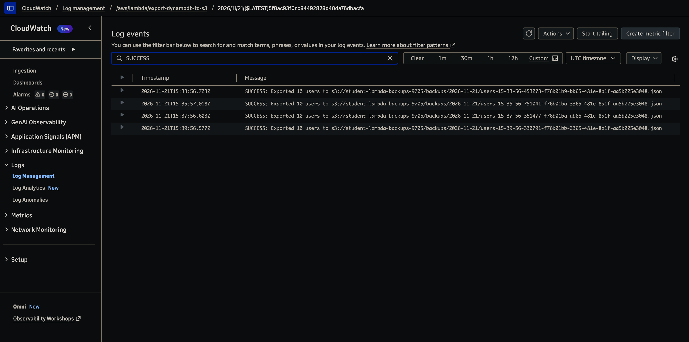

---

## Part E: monitoring, retention and cleanup

**Step 15. Metrics.** Lambda #2's Monitor tab over 3 hours: **23 invocations** from the schedule, a duration of about **460–610 ms** (average 502 ms), **0 errors** and a **100% success rate**.


Lambda #1 over 1 day: **2 invocations**, the first test and the second run from Step 8. Both succeeded, with no errors.


**Step 16 (optional). Lifecycle rule.** `expire-demo-backups-after-7-days` applies only to the `backups/` prefix and expires backup files 7 days after they are created. That way a forgotten schedule can't fill the bucket for ever.

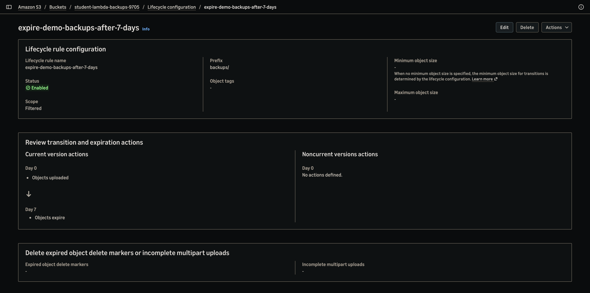

**Step 19. Cleanup.** I deleted every lab resource, stopping the schedule first so no new files were written while I cleaned up.

1. **Disabled** the schedule.

   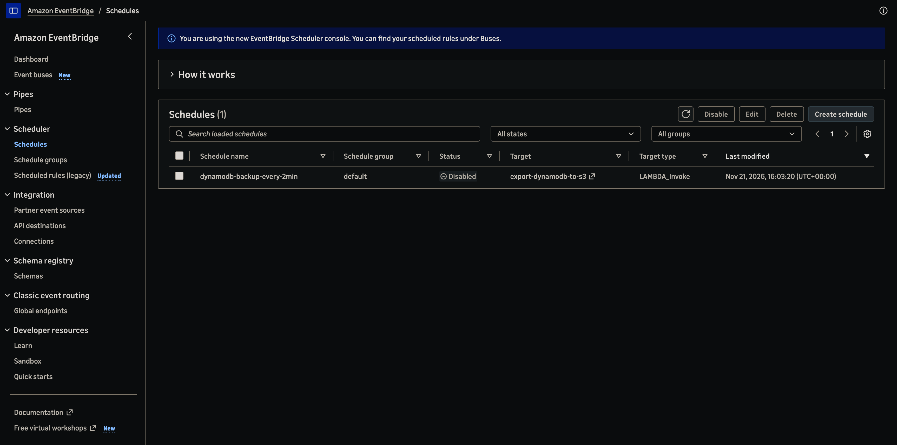

2. **Deleted** the schedule.

   

3. **Emptied and deleted** the S3 bucket. A search for it now finds no match.

   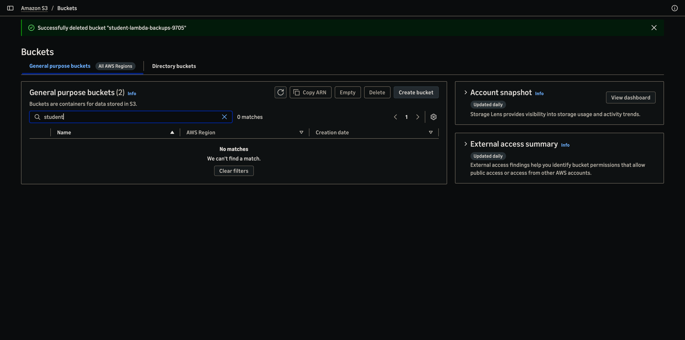

4. **Deleted** both Lambda functions.

   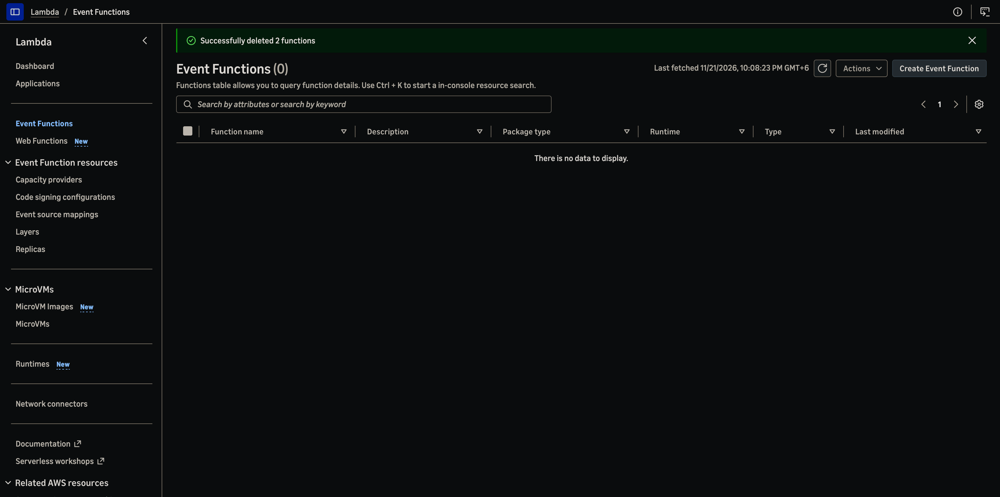

5. **Deleted** the DynamoDB table, without creating an on-demand backup.

   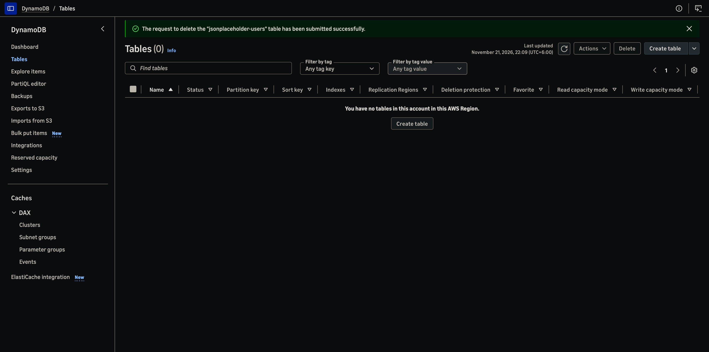

6. **Deleted** the two lab log groups. Log groups stay behind after their functions are deleted, so they need deleting separately.

   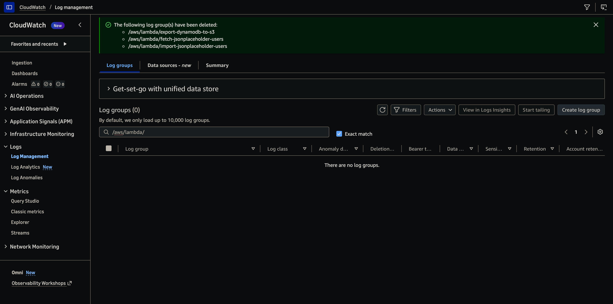

7. **Deleted** the three lab IAM roles: both Lambda execution roles and the Scheduler role. None of them is in the roles list any more.

   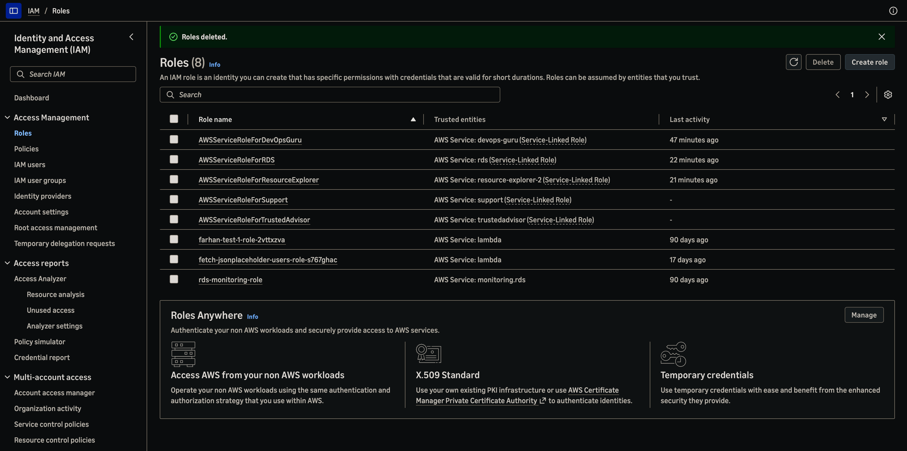

---

## Answers to the report questions

### 1. What is the difference between Lambda's execution role and Scheduler's execution role?

They're used by different services for different jobs:

- **Lambda's execution role** is assumed by the **Lambda service** while the function runs. Its permissions decide **what the function's code can do**. Boto3 picks up its temporary credentials automatically. Here, Lambda #1's role allows `dynamodb:PutItem`, Lambda #2's role allows `dynamodb:Scan` and `s3:PutObject`, and both can write logs.
- **Scheduler's execution role** is assumed by **EventBridge Scheduler** when a schedule fires. Its permission decides **what Scheduler can start**: here, only `lambda:InvokeFunction` on `export-dynamodb-to-s3`. It gives no access to DynamoDB or S3.

So the Scheduler role controls *who can start* Lambda #2, and Lambda #2's own role controls *what it may do* once it's running. Keeping them apart means Scheduler can't read the table or touch the bucket, and the function can't invoke other things.

### 2. Why does running Lambda #1 twice not produce 20 DynamoDB users?

`id` is the table's partition key, which makes it the item's unique identifier. `PutItem` writes a whole item: if an item with the same key already exists, it **replaces** it instead of adding a second one. The API returns the same 10 users with ids 1–10 every time. So the second run overwrote the 10 existing items with identical data, and the table still had 10 items. Screenshot 24 shows Lambda #1 was invoked twice. To keep every run's data, each write would need a different key, for example an extra sort key such as the import time.

### 3. Why do Lambda #2 backups have unique timestamps and request IDs?

Each export is written to its own key:

```text
backups/<UTC date>/users-<HH-MM-SS-microseconds>-<Lambda request ID>.json
e.g. backups/2026-11-21/users-07-11-53-714932-99802b96-affe-40e0-86f2-ed9f385dba0c.json
```

- **No overwriting.** `PutObject` to an existing key replaces that object. A fresh key for every run means each export is kept as its own file, which is why the folder grew file by file (screenshot 21).
- **Uniqueness, even at the same moment.** Two invocations in the same second, such as a manual test and a scheduled run, or a retry, still get different keys. The microseconds differ, and the request ID is unique per invocation.
- **Traceability.** The request ID ties a file to its exact log lines. The file above matches `RequestId: 99802b96-…` in the CloudWatch log (screenshots 15 and 18).
- **Ordering.** The date folder and the time make files easy to sort and find by when they were made. They're in UTC, so they don't depend on the viewer's time zone.

### 4. What is the difference between `print()` logs and `Invocations`/`Errors` metrics?

- **`print()` logs** are the function's own text output. Lambda sends whatever the code prints to **CloudWatch Logs**, one log stream per execution environment, together with the runtime's `START`, `END` and `REPORT` lines. They show **what happened inside a run**: `Saved user 3: Clementine Bauch`, `Read 10 items…`, or an `ERROR:` message with the reason.
- **`Invocations` and `Errors`** are **CloudWatch Metrics**, numbers that Lambda publishes automatically without any code. `Invocations` counts how many times the function ran. `Errors` counts runs that ended in an unhandled exception. Duration, throttles and so on come the same way. They show **how often, how long, and whether it failed**, summed over time periods (screenshots 23 and 24).

Metrics are for spotting a problem, such as errors going above 0 or a missing invocation. Logs are for finding out why. Details like the number of users are only in the logs, not in any metric. That's also why both functions re-raise exceptions after printing `ERROR:`. If they printed the error and returned normally, the run would still count as a success in the `Errors` metric.

### 5. What would happen if you deleted the DynamoDB table but kept its JSON files in S3? Could the original indexes/configuration be automatically restored from the JSON alone?

The **data** would survive: each JSON file holds every user's attributes as they were when the scan ran. But **nothing would be restored automatically**, and the table configuration would be lost:

- Each JSON file is just an array of items. It has no table name, no key schema (`id` as a Number partition key), no capacity mode, secondary indexes, TTL, streams, PITR setting, encryption, tags, resource policy or alarms. None of that can be rebuilt from the JSON.
- To get the data back, I'd have to create a new table by hand with the right key schema and settings, then write a script that reads a backup file and calls `PutItem` (or `BatchWriteItem`) for each user.
- Even then it might not be an exact copy. The export turned DynamoDB numbers into plain JSON numbers, and any non-whole numbers into strings, so some types might not come back the same. Each file is also a `Scan`, not a consistent point-in-time snapshot of the table.

In this lab the 7-day lifecycle rule would also delete those files after a week. Real restores should use DynamoDB's own backups (on-demand backup, PITR, or AWS Backup), which restore the table's data and its key schema and indexes.

### 6. Why is an export every 2 minutes usually a poor production backup strategy for large DynamoDB tables?

- **It reads the whole table every time.** A full `Scan` consumes read capacity for every item, 720 times a day, even if nothing has changed. That is slow and expensive for a big table, and it competes with the application's own reads.
- **Lambda limits.** One invocation can run for at most 15 minutes, and this code keeps every item in memory to write a single file. A large table wouldn't fit in time or in memory.
- **Not a consistent snapshot.** A scan reads pages over time while the table keeps changing, so a file can mix data from different moments. It doesn't capture configuration either (see question 5).
- **Storage piles up.** That's about 30 files an hour, 720 a day, and over 21,000 a month, each a full copy of the table, with growing storage and request costs.
- **Overlapping runs.** If one export takes longer than 2 minutes, the next one starts before it finishes, and duplicate scans run in parallel.
- **Restoring is manual.** A custom script is needed, and nobody has tested it.

Better options for production are **DynamoDB point-in-time recovery** (restore to any second in the last 35 days), **on-demand backups** or **AWS Backup**, and the managed **DynamoDB export to S3** (full or incremental, without using table read capacity). Choose the interval and retention from the workload's RPO and RTO.

---

## Notes

- **UTC vs local time.** The folder date, the times in file names, and CloudWatch timestamps are in **UTC**. The S3 "Last modified" column and the console's other dates are in my local time, **UTC+6**. For example, `users-15-35-56-….json` shows as last modified at 21:35:57.
- **The schedule is approximate.** `rate(2 minutes)` ran about every 2 minutes, give or take a second or so (15:33:56, 15:35:57, 15:37:56 …). That matches the assignment's note that a rate doesn't promise an exact second.
