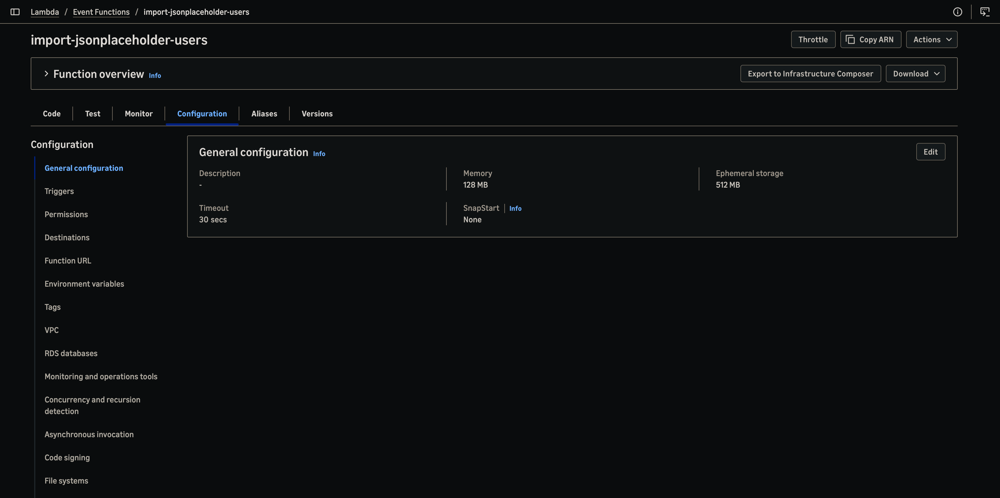
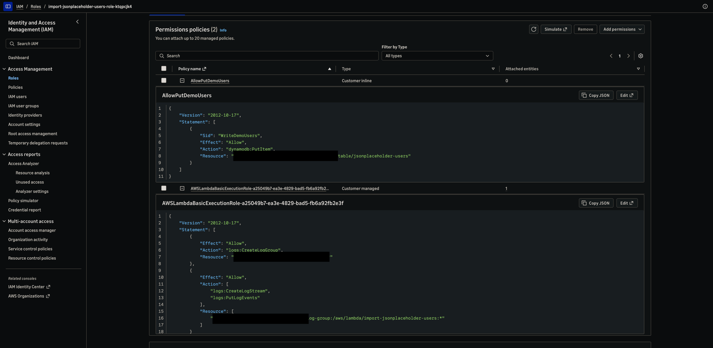

# AWS Lambda + DynamoDB + Scheduled S3 Backups

A serverless pipeline built in the AWS Management Console. One Lambda function loads 10 demo users from a public API into DynamoDB. A second Lambda function exports the whole table as a new timestamped JSON file in a private S3 bucket. EventBridge Scheduler runs that export every 2 minutes, and CloudWatch shows the logs and metrics for both functions.

Everything was built in **US West (Oregon), `us-west-2`**, on 21 November 2026, then deleted at the end. The original task description is in [ASSIGNMENT.md](ASSIGNMENT.md).

> **About the screenshots:** the AWS console's top bar, which shows the account name and ID, is cropped off every screenshot. The account ID inside ARNs is blacked out.

## Architecture

```text
            https://jsonplaceholder.typicode.com/users
                              |
                              | HTTP GET (10 demo users)
                              v
            [Lambda #1: import-jsonplaceholder-users]
                              |
                              | dynamodb:PutItem
                              v
               [DynamoDB table: jsonplaceholder-users]
                              |
                              | dynamodb:Scan
                              v
            [Lambda #2: export-dynamodb-to-s3]  <---  [EventBridge Scheduler]
                              |                         rate(2 minutes)
                              | s3:PutObject
                              v
            [Private S3 bucket: student-lambda-backups-9705]
               backups/YYYY-MM-DD/users-HH-MM-SS-ffffff-REQUEST_ID.json

            Both functions ---> CloudWatch Logs + CloudWatch Metrics
```

How the data flows:

1. **Lambda #1** (run by hand from the Test tab) calls the JSONPlaceholder API and gets a list of 10 users. It writes each one to DynamoDB with `PutItem`, using the user's `id` as the key.
2. **DynamoDB** stores the users, including the nested `address` and `company` objects.
3. **Lambda #2** reads the whole table with `Scan`, following `LastEvaluatedKey` if there's more than one page. It sorts the users by `id` and uploads them as one JSON array to S3 with `PutObject`.
4. **EventBridge Scheduler** invokes Lambda #2 every 2 minutes, so a new backup file appears in S3 every 2 minutes without anyone touching it.
5. **CloudWatch** keeps each function's `print()` output in its log group, and the invocation, duration and error metrics.

Neither function has any AWS keys in its code. Boto3 gets temporary credentials from each function's IAM execution role.

## Resources created

| Resource | Name | Key settings |
| --- | --- | --- |
| DynamoDB table | `jsonplaceholder-users` | Partition key `id` (Number), no sort key, on-demand capacity |
| S3 bucket | `student-lambda-backups-9705` | `us-west-2`, Block all public access **On**, no bucket policy, default encryption |
| Lambda #1 | `import-jsonplaceholder-users` | Python 3.12, 128 MB, 30 s timeout, handler `lambda_function.lambda_handler` |
| Lambda #2 | `export-dynamodb-to-s3` | Python 3.12, 128 MB, 30 s timeout, handler `lambda_function.lambda_handler` |
| Inline IAM policy | `AllowPutDemoUsers` | On Lambda #1's role: `dynamodb:PutItem` on the table only |
| Inline IAM policy | `AllowDynamoDBJsonBackup` | On Lambda #2's role: `dynamodb:Scan` on the table, `s3:PutObject` on `backups/*` only |
| EventBridge schedule | `dynamodb-backup-every-2min` | `rate(2 minutes)`, flexible time window off, target Lambda #2, its own Scheduler role |
| S3 lifecycle rule (optional) | `expire-demo-backups-after-7-days` | Prefix `backups/`, current versions expire after 7 days |

## Repository layout

```text
.
├── README.md          this report
├── ASSIGNMENT.md      the original assignment instructions
├── lambda_src/        Python source of both functions (unchanged)
├── lambda_zips/       the two ZIPs uploaded to Lambda (unchanged)
├── iam_policies/      policy templates; REGION, ACCOUNT_ID and the bucket name stay as placeholders
└── screenshots/       the 32 screenshots used below
```

---

## Part A: DynamoDB table and S3 bucket

**Step 1–2. The DynamoDB table.** I created `jsonplaceholder-users` with the partition key `id` of type **Number**, because the API's ids are numbers (1–10). The item count is 0 here because nothing had been imported yet.


**Step 3. The private S3 bucket.** I created `student-lambda-backups-9705` in the same Region as everything else.


**Block all public access** stayed **On** and the bucket has no bucket policy, so the backups are private.


---

## Part B: Lambda #1, import users into DynamoDB

**Step 4. Create the function.** `import-jsonplaceholder-users` uses Python 3.12. I raised the timeout from the default 3 seconds to **30 seconds**, because the function makes an HTTP call to an outside API.



**Step 5. IAM permission.** The function's execution role got one inline policy, `AllowPutDemoUsers`, which allows only `dynamodb:PutItem` on this one table. The second policy, `AWSLambdaBasicExecutionRole-…`, was added by Lambda when it created the role. It lets the function write its logs to CloudWatch.



**Step 6. Environment variable and code.** `TABLE_NAME` tells the code which table to write to, so the table name isn't hardcoded.


I uploaded `lambda_zips/lambda-import-users.zip`. The handler is `lambda_function.lambda_handler` and the runtime is Python 3.12.


**Step 7. Test.** A test event `ImportUsersTest` with `{}` returned `statusCode 200` and `saved_count: 10`.


The log stream in `/aws/lambda/import-jsonplaceholder-users` shows each user being saved, then the `SUCCESS` line.


**Step 8. The data in DynamoDB.** Explore items → Scan returned **10 items**, one per user.


Each item keeps the user's full record, including the nested `address` (with `geo`) and `company` objects.


I then ran Lambda #1 a second time, and the table still held 10 items, not 20. The reason is in [question 2](#2-why-does-running-lambda-1-twice-not-produce-20-dynamodb-users) below. Screenshot 24 confirms the two runs.

---

## Part C: Lambda #2, export DynamoDB to S3

**Step 9. Create the function.** `export-dynamodb-to-s3` has the same settings: Python 3.12, 128 MB, 30 seconds.


**Step 10. IAM permissions.** The inline policy `AllowDynamoDBJsonBackup` has two statements:
- `dynamodb:Scan` on the `jsonplaceholder-users` table;
- `s3:PutObject` on `arn:aws:s3:::student-lambda-backups-9705/backups/*`, so the function can only write under `backups/`. It can't read, list or delete anything in the bucket.


**Step 11. Environment variables and code.** The function reads all three settings from environment variables. I uploaded `lambda_zips/lambda-backup-to-s3.zip`, and the handler is `lambda_function.lambda_handler`.


**Step 12. Manual tests.** The test event `ExportUsersTest` (`{}`) returned `exported_count: 10`, the new file's `s3_uri`, and `scan_pages: 1`. The table is tiny, so one scan page held all of it.


I ran the test twice. Each run created its own file under `backups/2026-11-21/` instead of overwriting the first one.


A downloaded backup file is a JSON array of the 10 users, with every field and the nested objects:


The log stream for `/aws/lambda/export-dynamodb-to-s3` shows both manual runs: reading the table, `Read 10 items over 1 DynamoDB scan page(s)`, and the `SUCCESS` line with the file's S3 URI.


---

## IAM: why each function gets different permissions

Each function's role allows only what its code calls, on only the resource it needs (least privilege):

| Function | Needs | Why |
| --- | --- | --- |
| Lambda #1 (import) | `dynamodb:PutItem` on the table | It only **writes** users into the table. It never reads the table and never touches S3. |
| Lambda #2 (export) | `dynamodb:Scan` on the table | It has to **read every item** in the table. |
| Lambda #2 (export) | `s3:PutObject` on `bucket/backups/*` | It only **creates** new backup files, and only under `backups/`. |
| Both | `AWSLambdaBasicExecutionRole-…` (logs) | To create their log group and stream and write `print()` output to CloudWatch. |

Neither function can delete or change data it doesn't own. If Lambda #2's code had a bug, it still couldn't modify DynamoDB or delete earlier backups. The policy templates in `iam_policies/` keep `REGION`, `ACCOUNT_ID` and `YOUR_UNIQUE_BUCKET_NAME` as placeholders. I entered the real values only in the IAM console.
